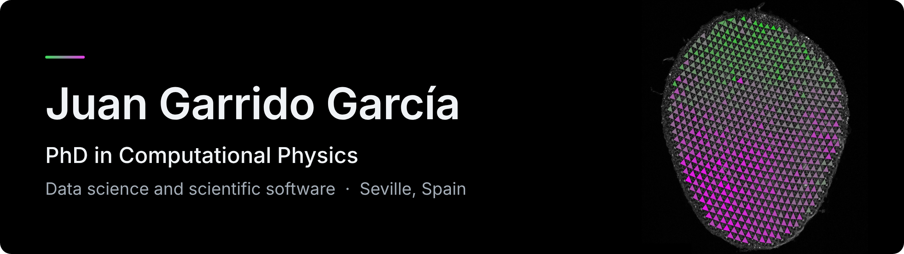
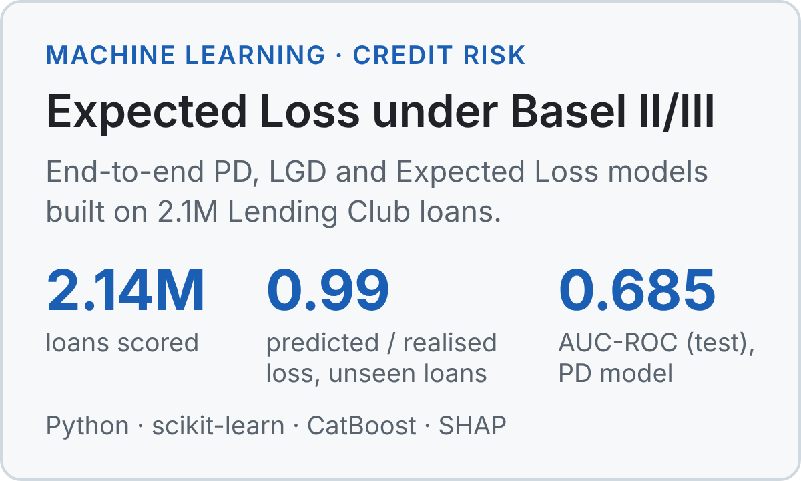
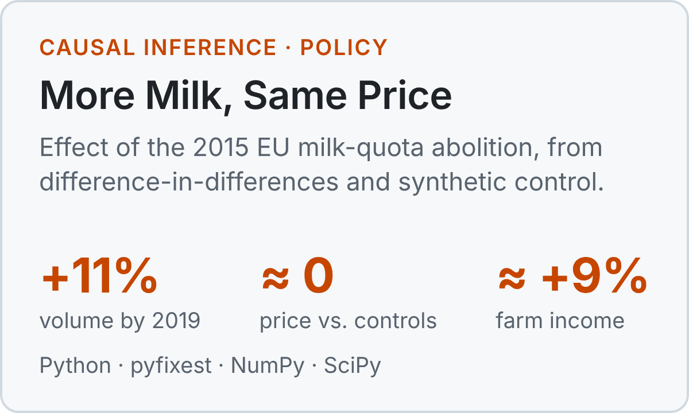
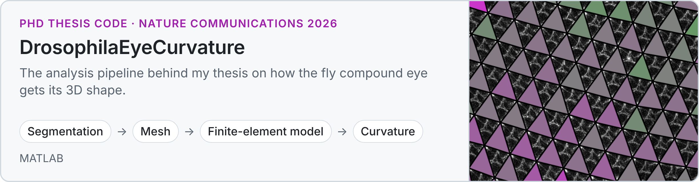

  

  <a href="https://www.linkedin.com/in/juan-garrido-garc%C3%ADa-phd"><picture><source media="(prefers-color-scheme: dark)" srcset="assets/linkedin-dark.png"></picture></a>
  &nbsp;
  <a href="https://orcid.org/0000-0003-4116-3546"><picture><source media="(prefers-color-scheme: dark)" srcset="assets/orcid-dark.png"></picture></a>

I am a computational physicist who builds software. During my PhD at the Universidad de Sevilla (cum laude, FPI fellowship) I was the only computational physicist on the project. I wrote and maintained the pipeline that turns microscopy images of the fly eye into 3D meshes, a finite-element model and curvature measurements, and that work is now published in *Nature Communications*.

Since then I have been building data science projects in Python, from credit-risk modelling to causal inference.

**Currently looking for data science and software roles, remote or in Seville.**

## Selected work

  <a href="https://github.com/JuanGarridoGarcia/A-Deep-Dive-into-Expected-Loss-through-Credit-Scoring-Industry-Standard-Machine-Learning"><picture><source media="(prefers-color-scheme: dark)" srcset="assets/credit-dark.png"></picture></a>
  <a href="https://github.com/JuanGarridoGarcia/More-Milk-Same-Price-Causal-Evaluation-EU-Milk-Quota-Abolition-"><picture><source media="(prefers-color-scheme: dark)" srcset="assets/milk-dark.png"></picture></a>

  <a href="https://github.com/ComplexOrganizationOfLivingMatter/DrosophilaEyeCurvature"><picture><source media="(prefers-color-scheme: dark)" srcset="assets/thesis-dark.png"></picture></a>

## Publications

- [**A natural programmable metamaterial controls 3D curvature of compound eyes**](https://doi.org/10.1038/s41467-026-74276-6) 
  **Garrido-García, J.**, Walther, R.F., Torres-Tirado, J., Andrés-San Román, J.A., Sanz-Herrera, J.A., Pichaud, F., Casares, F. & Escudero, L.M. 
  *Nature Communications* 17, 5553 (2026). Featured in [La Razón](https://www.larazon.es/ciencia/cientificos-espanoles-descubren-nuevo-material-inspirado-ojo-moscas_202606306a4385a426ebc75a77f86a95.html), [eldiario.es](https://www.eldiario.es/spin/investigadores-espanoles-descubren-ojo-mosca-utiliza-ingenieria-ultima-generacion-pm_1_13345597.html) and [Europa Press](https://www.europapress.es/andalucia/noticia-investigadores-andaluces-descubren-primer-metamaterial-programable-organismo-vivo-20260630110648.html).

- [The interplay of curvature, geometry and topology shapes tissue organisation in epithelial shells](https://doi.org/10.1002/advs.77487) 
  Morato, L., Andrés-San Román, J.A., **Garrido-García, J.**, Gordillo-Vázquez, C., Palacios, A.M., Lidueña-Fernández, E., McDole, K., Gómez-Gálvez, P., Annese, V. & Escudero, L.M. 
  *Advanced Science* (2026).

- [Local and global changes in cell density induce reorganisation of 3D packing in a proliferating epithelium](https://doi.org/10.1242/dev.202362) 
  Barone, V., Tagua, A.J., Andrés-San Román, J.A., Hamdoun, A., **Garrido-García, J.**, Lyons, D. & Escudero, L.M. 
  *Development* (2024).

- [Incorporation of a Metal Catalyst for Ammonia Synthesis in a Ferroelectric Packed-Bed Plasma Reactor: Does It Really Matter?](https://doi.org/10.1021/acssuschemeng.2c05877) 
  de Navascués, P., **Garrido-García, J.**, Cotrino, J., Rodríguez González-Elipe, A. & Gómez Ramírez, A.M. 
  *ACS Sustainable Chemistry & Engineering* (2023).

## Toolbox

<picture><source media="(prefers-color-scheme: dark)" srcset="assets/toolbox-dark.png"></picture>

Also: pandas, NumPy, SciPy, LightGBM, CatBoost, SHAP and pyfixest.

About the images

 
The banner and the thesis card show a <i>Drosophila</i> compound eye from my PhD thesis. Each triangle joins three neighbouring ommatidia, the units that make up the eye, and its colour shows its area: magenta triangles are larger than green ones.
Figure adapted from <a href="https://doi.org/10.1038/s41467-026-74276-6">Garrido-García et al., <i>Nature Communications</i> 2026</a>.
Tool icons from <a href="https://github.com/tandpfun/skill-icons">skill-icons</a> (MIT licence).

